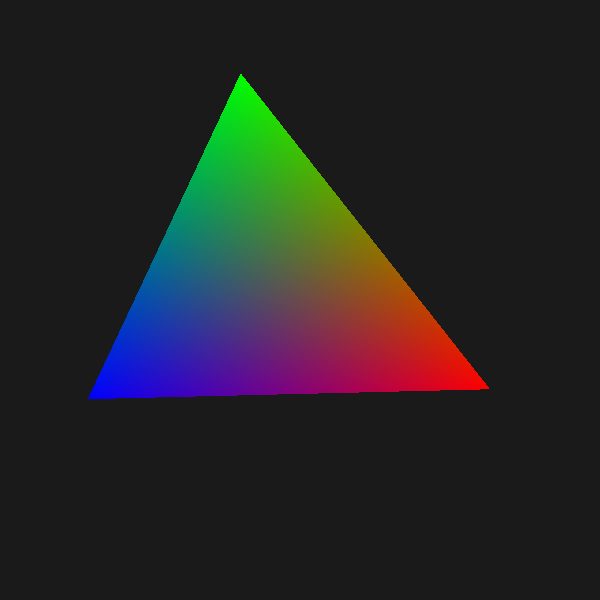

# wgpu in GL Area

This example shows how to use [wgpu](https://wgpu.rs) to draw in a `gtk::GLArea`.

wgpu's GLES backend is created from the GL context of the `GLArea`, and the
framebuffer that GTK binds before emitting `render` is wrapped as a wgpu texture,
so wgpu draws directly into the widget.

On macOS, wgpu's GLES backend needs [ANGLE](https://chromium.googlesource.com/angle/angle).

